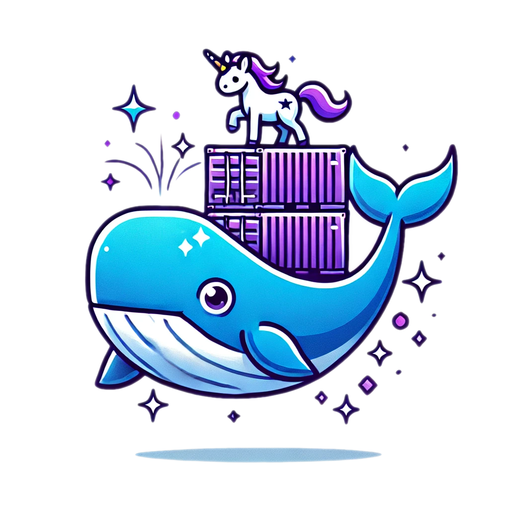

# **Introduction to Docker**

The adventures of Docker and the
Space Purple Unicorn Association

uomresearchit.github.io/docker-introduction/

---

## The plan

* Morning
    - Introduction
    - Docker Desktop
    - Building our Docker CLI toolkit
    - --- Break ---
    - Sharing information with containers
    - The Docker Hub
    - Configuring containers
    - --- Lunch Break ---

* Afternoon
  - Creating your own container images
  - --- Break ---
  - Using Docker Compose
  - Microservices
  - Conclusion

---

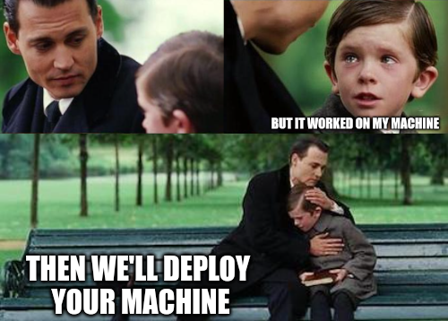

* ## Why containers?
  * Reliable Software
  * Microservices

* ## Why Docker?

  * Most popular/mature
  * Easy to convert from docker to others

---

### The Space Purple Unicorn Association

The Space Purple Unicorn Association is a community effort to count the number of purple unicorns in space.

We are a friendly group of developers, data scientists, and unicorn enthusiasts, who are passionate about surveying and conserving the purple unicorn population.

We're delighted to have you join us!
To support the community's efforts, we have created a set of tools and resources to help count the number of purple unicorns in space.
These tools are distributed via Docker.

Please help us preserve this keystone species by running your own Space Purple Unicorn Counting service,
and encouraging your local community to join in the count!

---

### Start helping now!

You can use the <i>Space Purple Unicorn Counter</i> (<strong>SPUC</strong>) container image for your service,
which you can find on Docker Hub.

This image runs a web app that can be used to record sightings.

Remember to allow access to the container from the host machine by <strong>configuring a port</strong> to forward requests to the container.

To change the format of the sightings report, you may edit the `print.config` file.

---

### Docker Desktop

The next ~20 minutes will be demonstrative, but are a useful introduction to the concepts.

If you have Docker Desktop, we encourage you to  **not**  try to follow along, and instead focus on absorbing ideas.

---

---

---

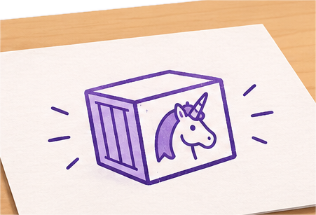

---

---

---

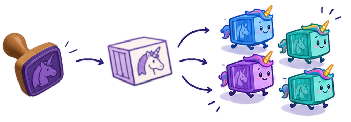

---

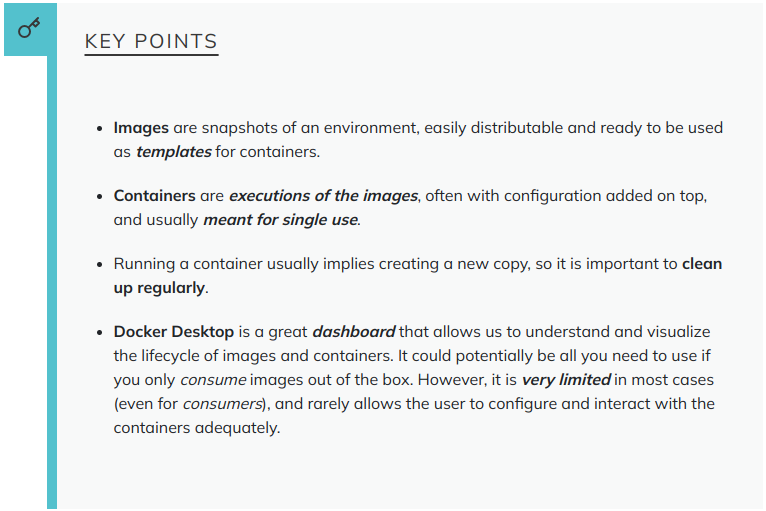

---

  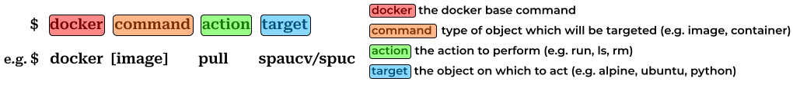

---

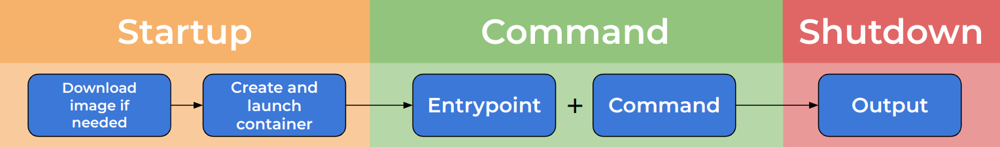

---

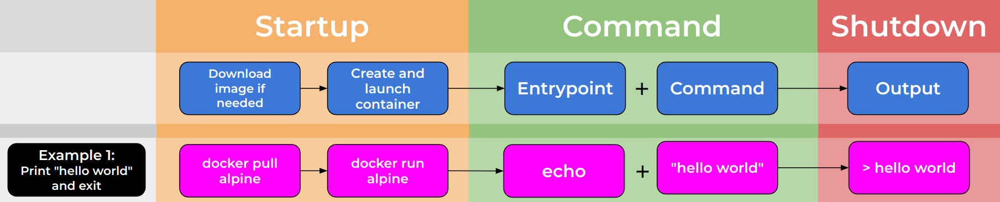

---

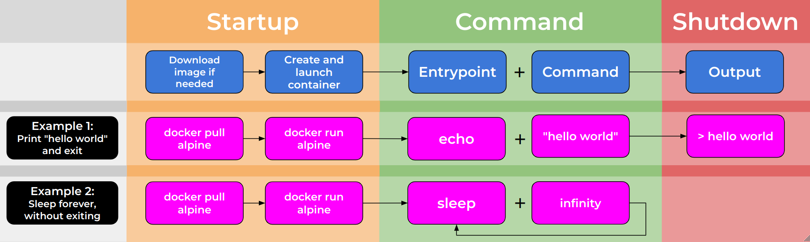

---

---

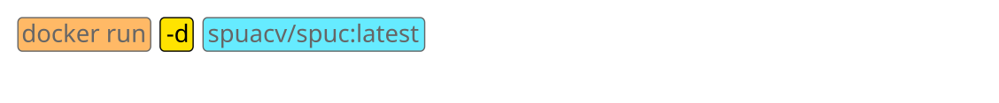

---

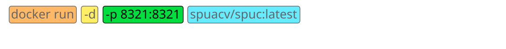

---

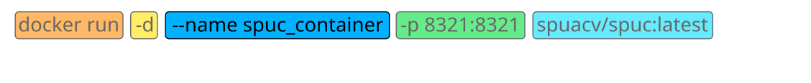

---

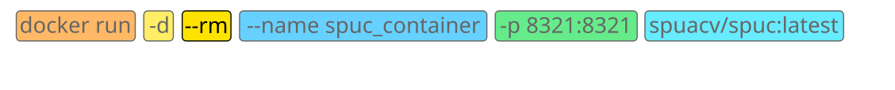

---

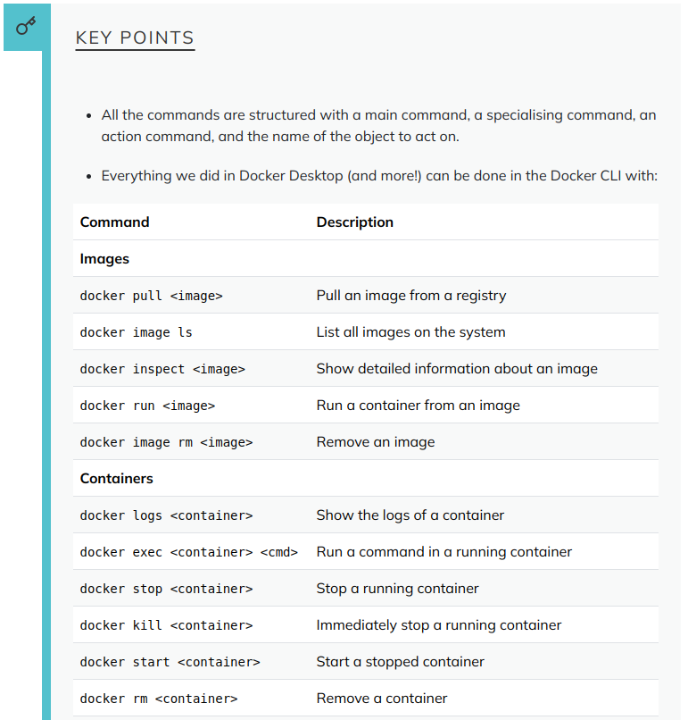

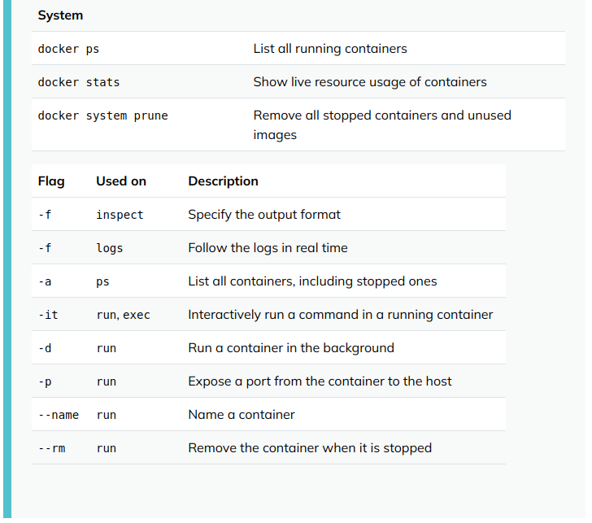

---

<h1> Break! </h1>

---

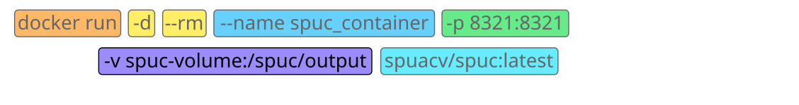

---

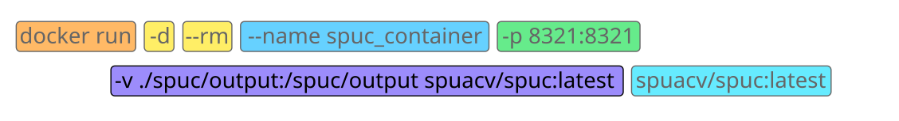

---

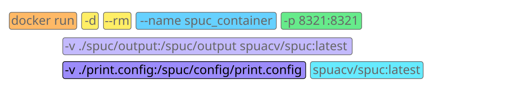

---

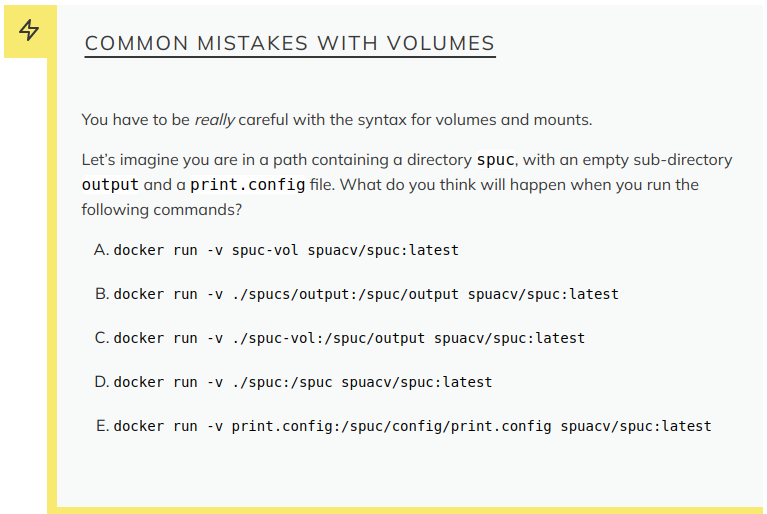

---

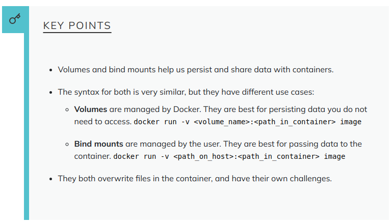

---

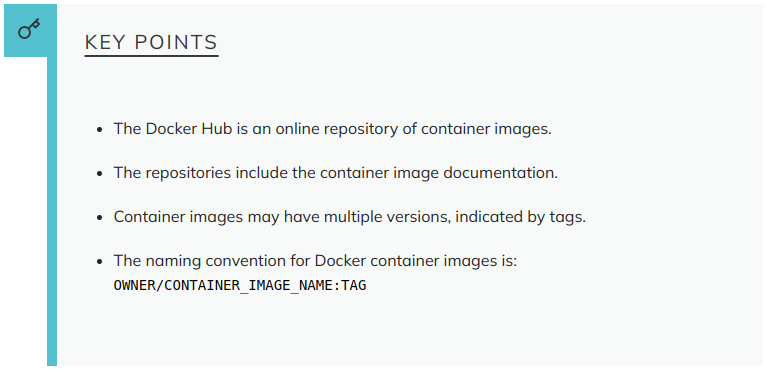

---

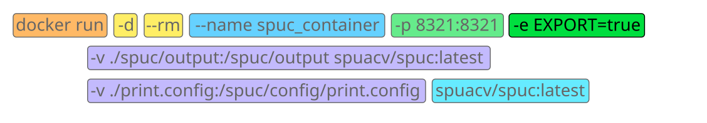

---

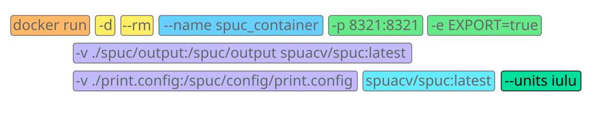

---

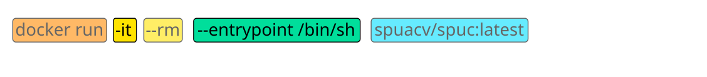

---

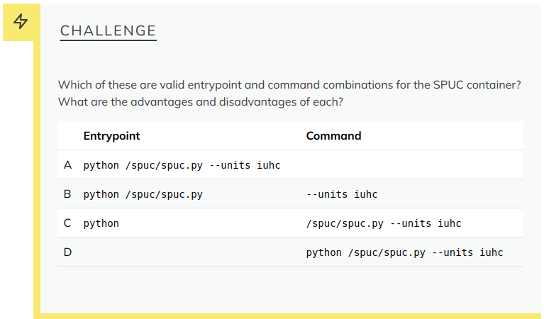

---

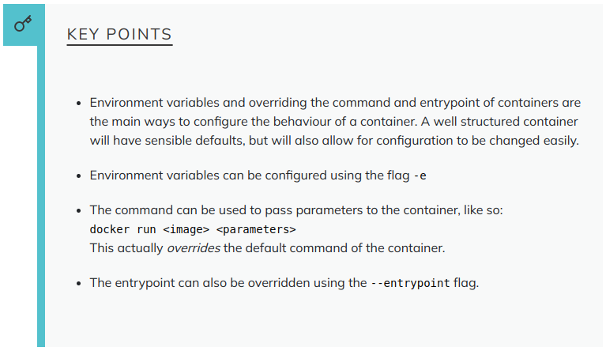

---

<h1> Lunch! </h1>
